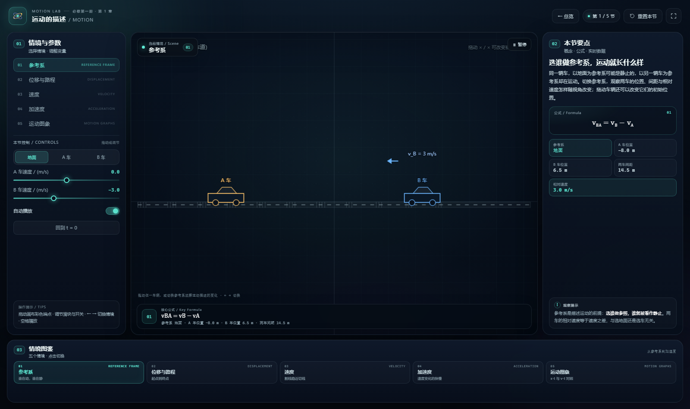

# 运动的描述 · MOTION

一个可直接双击打开的单文件动态教学网页，对应必修第一册 · 第 1 章。
本页包含 5 个可拖拽、可调节的教学情境，图形、公式与实时数据同步联动。

直接用浏览器打开 [index.html](index.html) 即可，**无需联网、无需安装依赖、无需启动服务**。



---

## 快速开始

1. 双击 `index.html`（推荐 Chrome / Edge / Firefox / Safari 近年版本）。
2. 在左侧「情境与参数」中切换 5 个情境，或点击底部「情境图鉴」。
3. 拖动画布端点，调节左栏滑块、开关与按钮；带播放键的情境可看完整过程。
4. 顶部「重置本节」恢复当前情境；「全屏」适合课堂投屏。
5. 键盘 `←` / `→` 切换情境；带播放按钮的情境可用空格播放。

---

## 五个情境

| 编号 | 情境 | 英文 | 关注点 | 操作提示 |
| --- | --- | --- | --- | --- |
| 01 | 参考系 | REFERENCE FRAME | 谁在动，谁在静 | 拖动任一车辆，或切换参考系观察运动描述的变化 |
| 02 | 位移与路程 | DISPLACEMENT | 起点到终点 | 拖动终点 B，比较轨迹长度（路程）与直线距离（位移） |
| 03 | 速度 | VELOCITY | 割线趋近切线 | 拖动 t₀ 或缩小 Δt，看割线斜率怎样趋近瞬时速度 |
| 04 | 加速度 | ACCELERATION | 速度变化的快慢 | 改变初速度与加速度，观察 v-t 图斜率与速度、加速度方向 |
| 05 | 运动图象 | MOTION GRAPHS | x-t 与 v-t 对照 | 切换运动类型，比较位置—时间与速度—时间图象的形状 |

---

## 页面结构

- 左栏：情境列表与当前情境的参数控件（滑块、开关、按钮）。
- 中栏：Canvas 动态图、情境徽标、底部核心公式与实时读数。
- 右栏：概念说明、公式卡、实时数据卡与观察提示。
- 底栏：情境图鉴，点击可在情境之间快速跳转。

每个情境使用独立主题色；导航、数据卡、公式条与画布同步换色。

---

## 文件说明

- `index.html`：**单文件交付**，HTML / CSS / JavaScript 已全部内联，可单独复制到任意目录双击打开。
- `preview.png`：页面预览图，供总览页使用。
- `README.md`：本说明。

本章目录只保留这三个交付文件。构建源文件统一归档在 `_template/src/运动的描述`，不随章节分发。

## 开发维护

源文件归档在 `_template/src/运动的描述`。修改后从仓库根目录运行：

```bash
python3 _template/build.py 运动的描述
python3 _template/make_readmes.py
```

---

## 验证与说明

- 页面无外网依赖，所有图形、字体与文字均使用系统能力绘制。
- 画布按 devicePixelRatio 缩放；窄屏自动改为「舞台 → 情境与参数 → 本节要点 → 情境图鉴」纵向堆叠。
- 拖动端点被限制在当前视野内；刷新后回到第一个情境。
